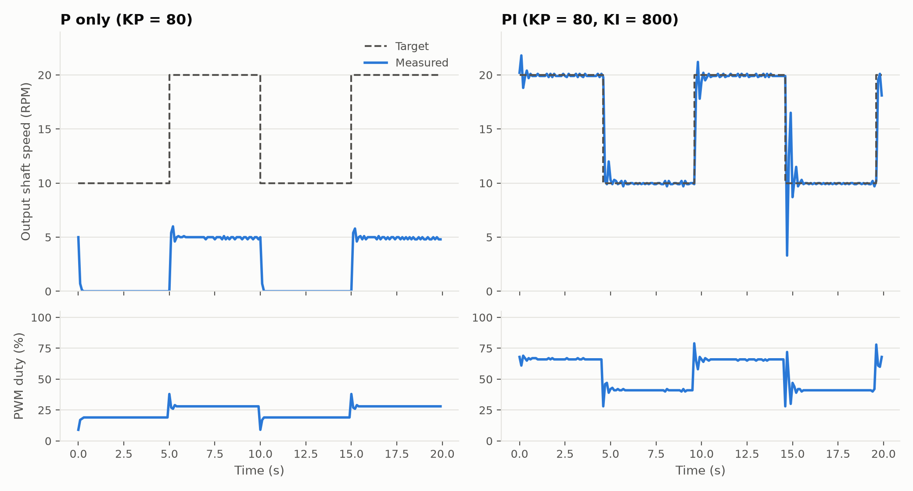

# STM32 Closed-Loop Motor Speed Control

PI speed controller for a small DC gearmotor, running on an STM32F446RE (Nucleo-64). The firmware reads the motor's quadrature encoder, computes output-shaft speed every 100 ms, and adjusts the PWM duty cycle to hold a target speed. The target alternates between 20 and 10 RPM every 5 seconds, and every sample is streamed over UART for logging.



## Results

**P only vs. PI** (plot above, from real logs in `docs/`):

| Controller | Target 20 RPM | Target 10 RPM |
|---|---|---|
| P only (KP = 80) | settles at ~4.8 RPM | stalls at 0 RPM |
| PI (KP = 80, KI = 800) | 19.8–20.1 RPM | 9.9–10.2 RPM |

With proportional control alone, the motor stalls or settles far below the target. The motor needs roughly 17% duty to overcome friction in the 298:1 gearbox, and P control only produces that much output when the error is large. Adding the integral term removes the steady-state error. The controller settles within about a second of each target change. The remaining ±0.2 RPM jitter is one encoder count per sample.

**Disturbance rejection:** squeezing the output shaft by hand drives the duty up to 100% to hold speed. When the load is released, the speed recovers within a few samples. Anti-windup keeps the integral from building up while the output is saturated.

One 20 → 10 RPM transition in the log briefly undershoots to ~3 RPM before settling. That's a sign KP could come down a little, or the target could be ramped instead of stepped.

## Characterizing the motor first

Before closing the loop, I ran the motor open-loop and measured it.

**Encoder calibration.** The datasheet math is 14 counts per motor revolution × 298:1 gearbox = **4,172 counts per output revolution**. To check it, the firmware ran the motor until the encoder reported exactly 10 revolutions, then braked. A tape flag on the shaft made 10 turns, and the counter stopped at 41,736 against a target of 41,720.

**Speed vs. duty** (4×AA, ~6.5 V):

| PWM duty | Output speed |
|---|---|
| 25% | 3.1 RPM |
| 50% | 13.2 RPM |
| 75% | 23.2 RPM |
| 100% | 33.3 RPM |

Above the deadband, the response is close to linear, at about 0.4 RPM per 1% of duty. Extrapolating to zero speed puts the deadband at ~17% duty. These numbers were used to pick the starting gains.

## How it works

- **PWM:** TIM3 channel 1 on PA6 drives the TB6612FNG's PWMA input. Duty resolution is 4,200 steps (ARR = 4199).
- **Direction:** PA8 and PA9 drive AIN1 and AIN2. Forward is AIN1 high, AIN2 low, and brake is both high.
- **Encoder:** TIM2 in hardware encoder mode on PA0/PA1, with the input filter and internal pull-ups enabled. The timer counts pulses in hardware, so no interrupts are needed per edge.
- **Speed measurement:** every 100 ms, the change in the encoder count is converted to RPM. Timing uses `HAL_GetTick()` instead of blocking delays, so the loop never stalls.
- **Controller:** a discrete PI controller, `u = KP·e + KI·∫e dt`, clamped to the PWM range. When the output saturates, that sample's integral contribution is undone (anti-windup).
- **Output:** `printf` over USART2 to the ST-LINK virtual COM port, at 115200 baud. Values are printed as scaled integers because the default newlib-nano build has no `%f`.

## Hardware

| Part | Role |
|---|---|
| STM32 Nucleo-F446RE | Microcontroller (Cortex-M4) with built-in ST-LINK |
| TB6612FNG breakout | Dual H-bridge motor driver |
| Adafruit #4641 | N20 micro gearmotor, 298:1, with magnetic quadrature encoder |
| 4×AA battery pack | Motor supply (VM) |
| 100 µF electrolytic capacitor | Bulk decoupling across VM and GND |

### Wiring

| From | To |
|---|---|
| Driver PWMA | D12 (PA6, TIM3_CH1) |
| Driver AIN1 / AIN2 | D7 (PA8) / D8 (PA9) |
| Driver VCC, STBY | 3V3 |
| Driver VM | Battery + |
| Driver AO1 / AO2 | Motor red / white |
| Motor black (encoder power) | 3V3 |
| Motor blue (encoder ground) | GND |
| Motor yellow / green (encoder A / B) | A0 (PA0) / A1 (PA1) |
| Battery −, driver GND, Nucleo GND | Common ground |

Motor wire colors are from the [Adafruit #4641 product page](https://www.adafruit.com/product/4641).

## Debugging notes

The encoder count stayed at 0 even though the motor was spinning. To find where the signal stopped, I added a test that polled `GPIOA->IDR` and counted level changes on PA0 and PA1. It reported zero edges, which ruled out the timer configuration and pointed to the hardware. A multimeter showed the encoder outputs sitting around 2.7 V instead of switching between 0 and 3.3 V. The cause was the encoder's power and ground wires being swapped. Checking the colors against the product page and swapping them fixed it.

## Building and running

1. The project was generated with STM32CubeMX (`motor_pid.ioc`) and builds with CMake using the STM32Cube extension for VS Code.
2. Build, then flash and run with the STM-Link GDB Server debug configuration.
3. Open a serial terminal on the ST-LINK COM port at 115200 baud.

To plot a run, enable logging in PuTTY (Session → Logging → Printable output), then:
```
python plot_response.py "P only (KP = 80)=docs/p_only.log" "PI (KP = 80, KI = 800)=docs/pi.log"
```

## Next steps

- Run the control loop from a timer interrupt instead of polling
- Use 4× quadrature decoding (TI12 mode) for finer speed resolution, which allows a faster loop
- Add feedforward from the measured speed-vs-duty curve to cut the transient error
- Ramp target changes instead of stepping them
- Support bidirectional control
